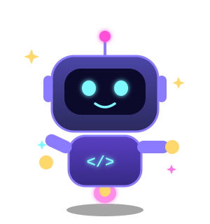

<!-- ============ BANNER ============ -->
<div align="center">



<a href="https://github.com/Umangsingh09">
  
</a>

</div>

<!-- ============ CONNECT ============ -->

## Connect with me 🤝

<a href="https://www.linkedin.com/in/umang-raj-445081311/"></a>
<a href="mailto:rajumang74@gmail.com"></a>
<a href="https://www.codechef.com/users/hard_yarn_96"></a>
<a href="https://github.com/Umangsingh09"></a>


<!-- ============ ABOUT ============ -->

## About Me 😊



- 🎓 B.Tech Computer Science student at Jaipur National University (2028)
- 🎮 Founder of **ROOKE**, a mobile esports tournament platform for Indian college and regional gamers
- 🧑‍💻 Backend / full-stack developer: Python, FastAPI, Django, Next.js, Flutter
- 🚀 I build real products for real use cases, not just coursework
- 🛠️ Freelance web developer, delivering client work from requirements to launch
- 🏆 Led teams across 10+ hackathons and organized one with **2,500+ registrations**
- 🧠 Learning DSA in C++ (trees → recursion → backtracking) and solving problems on CodeChef and LeetCode
- 🤝 Looking for a **backend / SDE internship** at a startup, and open to collaborating on projects
- 📫 How to reach me: [rajumang74@gmail.com](mailto:rajumang74@gmail.com)

<br clear="right"/>

## Stats 📊

<div align="center">


<br/>


</div>


<!-- ============ PROJECTS ============ -->

## Featured Projects 🔥

<div align="center">


</div>

**🎮 ROOKE: where college and regional gaming communities run real tournaments.**
Players discover and join tournaments, and organizers create and run them, with entry fees and prizes handled by the organizers themselves. It is built mobile-first with a phased growth and monetization plan, and Play Store release is in progress.


<br/><br/>

<table>
  <tr>
    <td width="50%" valign="top">
      <h3>🛒 Velora</h3>
      <b>Local marketplace app, built for a client</b><br/><br/>
      Sellers run their own stores; buyers browse, cart and order with phone-OTP login. Includes stock-gated publishing, a commission model and delivery-confirmed payouts (Razorpay Route).<br/><br/>
      
      
      
      
    </td>
    <td width="50%" valign="top">
      <h3>💳 GigCredit</h3>
      <b>AI credit access for gig workers (hackathon, team of 4)</b><br/><br/>
      Scores creditworthiness from alternative data such as platform earnings, ratings, delivery consistency and transaction patterns, for workers with no formal credit history. I led the team and architected the backend.<br/><br/>
      
      
      
      
    </td>
  </tr>
  <tr>
    <td width="50%" valign="top">
      <h3>🌌 DevSpace</h3>
      <b>Social platform for engineers</b><br/><br/>
      Co-founded the community and led a 10–12 member team. I built the full website solo: engineering feed, team collaboration, weekly challenges with certificates, reputation points and an opportunities board. <a href="https://www.devspace.website">Visit the site →</a>
    </td>
    <td width="50%" valign="top">
      <h3>🏠 Arivo</h3>
      <b>PG &amp; flat discovery</b><br/><br/>
      Discovery of PGs and flats, with property-management tools.
    </td>
  </tr>
</table>


<!-- ============ TECH STACK ============ -->

## Tech Stack 🧰

<div align="center">


</div>

| Area | Tools |
| :-- | :-- |
| **Languages** | Python, C++, Dart, JavaScript |
| **Backend** | FastAPI, Django, REST APIs, SQLAlchemy, Alembic, OTP auth |
| **Frontend & Mobile** | Flutter, React, Next.js |
| **Data & Deploy** | Supabase, PostgreSQL, Railway |
| **Tools** | Git, GitHub, VS Code |


<!-- ============ HACKATHONS ============ -->

## Hackathons &amp; Leadership 🏆

| Result | Event |
| :-- | :-- |
| 🥇 **Top 5** | Manipal University hackathon |
| 🥈 **Top 15 of 284 teams** | IIT Hyderabad, Agentic Fitness AI |
| 🥉 **Top 100** | GDG hackathon, LNMIIT Jaipur |
| 🏅 **Rank 9 of 120** | Hackathon Helper |
| 🎤 **Organizer** | Hosted a hackathon with 2,500+ registrations and secured a paying sponsor |


<!-- ============ DSA ============ -->

## DSA &amp; Problem Solving 🧠

Working on pattern recognition rather than memorizing solutions, through Striver's DSA Sheet and LeetCode.

<div align="center">


</div>

```text
Arrays → Hashing → Two Pointers → Sliding Window → Binary Search → Linked Lists → Stack & Queue → Trees (now) → Recursion & Backtracking → Graphs → DP
```


<!-- ============ SNAKE ============ -->

## Contribution Snake 🐍

<div align="center">

<picture>
  <source media="(prefers-color-scheme: dark)" srcset="https://raw.githubusercontent.com/Umangsingh09/Umangsingh09/output/github-snake-dark.svg" />
  <source media="(prefers-color-scheme: light)" srcset="https://raw.githubusercontent.com/Umangsingh09/Umangsingh09/output/github-snake.svg" />
  
</picture>

<br/><br/>


</div>

<!-- ============ CONTACT ============ -->

## Let's Connect 🚀

I'm looking for a **backend or software development internship**, ideally at a startup where I can ship real features. I'm also open to freelance projects, hackathon collaborations and talking to anyone in the esports community who wants to run tournaments on **ROOKE**.

<div align="center">

<a href="https://www.linkedin.com/in/umang-raj-445081311/"></a>
<a href="mailto:rajumang74@gmail.com"></a>

<br/><br/>


<br/>


</div>
